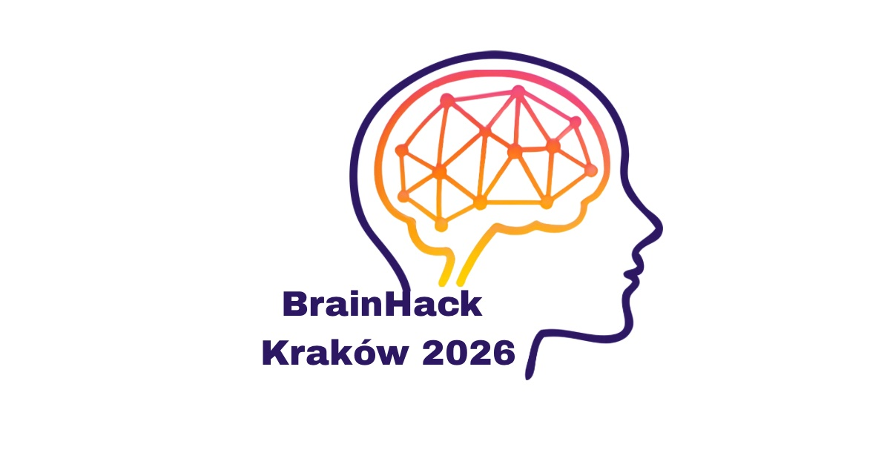

# NER-ASR Brain Hack

Projekt łączący rozpoznawanie mowy (ASR), wykrywanie nazwanych encji (NER) i analizę podobieństwa znaczeń zdań.
Wykonany w ramch warsztatów hackathonu Brain Hack Kraków 2026.

Obejmuje transkrypcję nagrań, rozróżnianie rozmówców, ocenę jakości transkrypcji oraz wykrywanie i maskowanie danych wrażliwych. Do porównywania znaczeń zdań wykorzystuje Sentence Transformers.

Kod znajduje się w [notatniku Jupyter](anonimizacja_asr_sentence_transformer.ipynb) przygotowanym do pracy w Google Colab z językiem polskim.
